# Frontend Design — Skill Repository

> A self-contained collection of **five** reproduction-grade frontend design skills and their live HTML artifacts. Each `.md` is a complete design system spec. Load it into any AI coding assistant (Claude Code, opencode, etc.) and it will restyle any plain HTML into a field-manual-grade interface with a single prompt. No CLI. No build step. No configuration.

---

## The five design systems

| # | Skill file | Aesthetic | Font stack | Theme | Example |
|---|---|---|---|---|---|
| 1 | `DeepNavy-HighQuality-Terminal-Aesthetics.md` | Deep navy‑slate editorial + teal terminal glow, scanlines, 1.3fr/1fr hero | Fraunces · Geist · JetBrains Mono | dark + light | `index.html` |
| 2 | `skill.md` | Editorial craft — warm parchment, rust‑red accent, lifted‑paper cards | Fraunces · Geist · JetBrains Mono | dark + light | `examples/BaseHtml-Revamped-with-DesignSkill/` |
| 3 | `DeepNavy-Fraunces-Pro.md` | Editorial‑technical dark navy + teal, grid + scanline overlay | Fraunces · Geist · JetBrains Mono | dark + light | (same stack as #1) |
| 4 | `Dark-Gold-Editorial-Report.md` | Financial journalism — gold accent, dark masthead, parchment body | DM Serif Display · DM Mono · Space Grotesk | light body + dark masthead | `examples/Dark-Gold-Editorial-Report.html` |
| 5 | `CyberPunk-Animated-Terminal-v1.md` & `v2` | Cyberpunk terminal — scrolling grid, neon triad, animated scanline borders | Orbitron · Fira Code | dark only | `examples/CyberPunk-Animated-Terminal-v2.html` (v1 `.md` is itself runnable HTML) |

All skill files live in [`frontend-design/`](frontend-design/). See [Previews](#previews) below for a screenshot of every system.

---

## Previews

One specimen page per design system, generated from its `.md` spec. Click a screenshot to open the HTML source; all pages live in [`examples/design-system-examples/`](examples/design-system-examples/).

### The five core systems

<table>
  <tr>
    <td width="50%" valign="top">
      <strong>#1 · DeepNavy HighQuality Terminal Aesthetics</strong><br>
      <a href="examples/design-system-examples/deepnavy-highquality-terminal-aesthetics.html">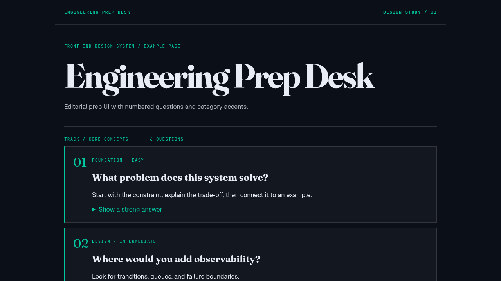</a><br>
      <sub>Spec: <a href="frontend-design/DeepNavy-HighQuality-Terminal-Aesthetics.md"><code>DeepNavy-HighQuality-Terminal-Aesthetics.md</code></a></sub>
    </td>
    <td width="50%" valign="top">
      <strong>#2 · Editorial Craft</strong><br>
      <a href="examples/design-system-examples/skill.html">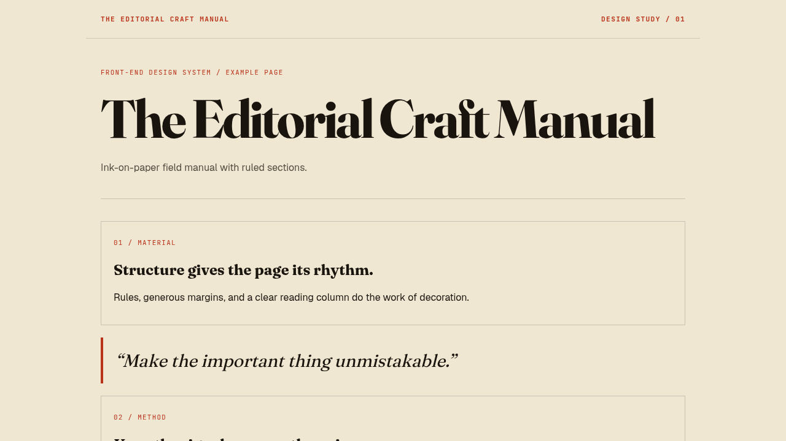</a><br>
      <sub>Spec: <a href="frontend-design/skill.md"><code>skill.md</code></a></sub>
    </td>
  </tr>
  <tr>
    <td width="50%" valign="top">
      <strong>#3 · DeepNavy Fraunces Pro</strong><br>
      <a href="examples/design-system-examples/deepnavy-fraunces-pro.html">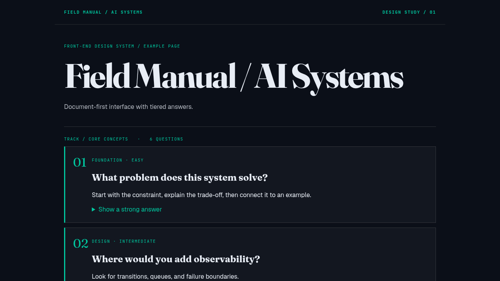</a><br>
      <sub>Spec: <a href="frontend-design/DeepNavy-Fraunces-Pro.md"><code>DeepNavy-Fraunces-Pro.md</code></a></sub>
    </td>
    <td width="50%" valign="top">
      <strong>#4 · Dark Gold Editorial Report</strong><br>
      <a href="examples/design-system-examples/dark-gold-editorial-report.html">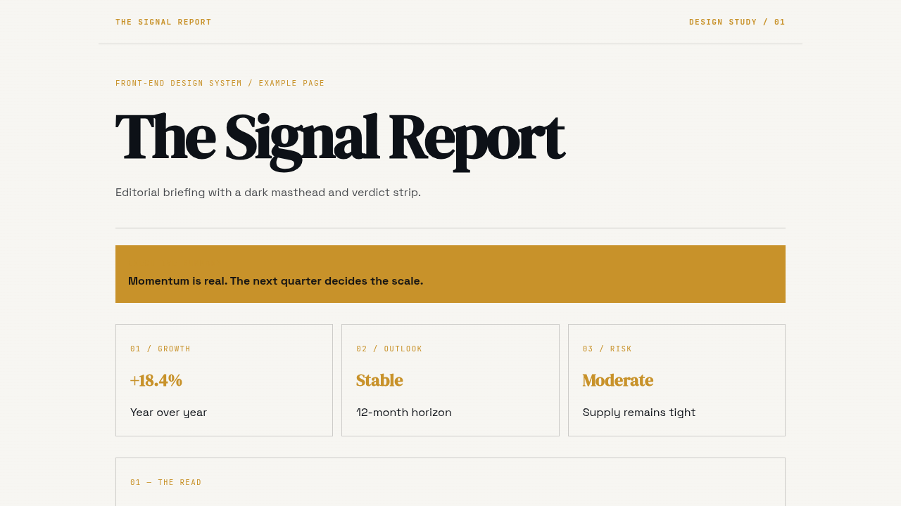</a><br>
      <sub>Spec: <a href="frontend-design/Dark-Gold-Editorial-Report.md"><code>Dark-Gold-Editorial-Report.md</code></a></sub>
    </td>
  </tr>
  <tr>
    <td width="50%" valign="top">
      <strong>#5 · CyberPunk Animated Terminal</strong><br>
      <a href="examples/design-system-examples/cyberpunk-animated-terminal-v1.html">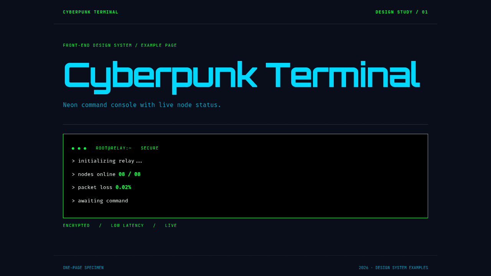</a><br>
      <sub>Spec: <a href="frontend-design/CyberPunk-Animated-Terminal-v1.md"><code>CyberPunk-Animated-Terminal-v1.md</code></a></sub>
    </td>
    <td width="50%" valign="top"></td>
  </tr>
</table>

### More design systems

<table>
  <tr>
    <td width="50%" valign="top">
      <strong>Amber Parchment Journal</strong><br>
      <a href="examples/design-system-examples/amber-parchment-journal.html">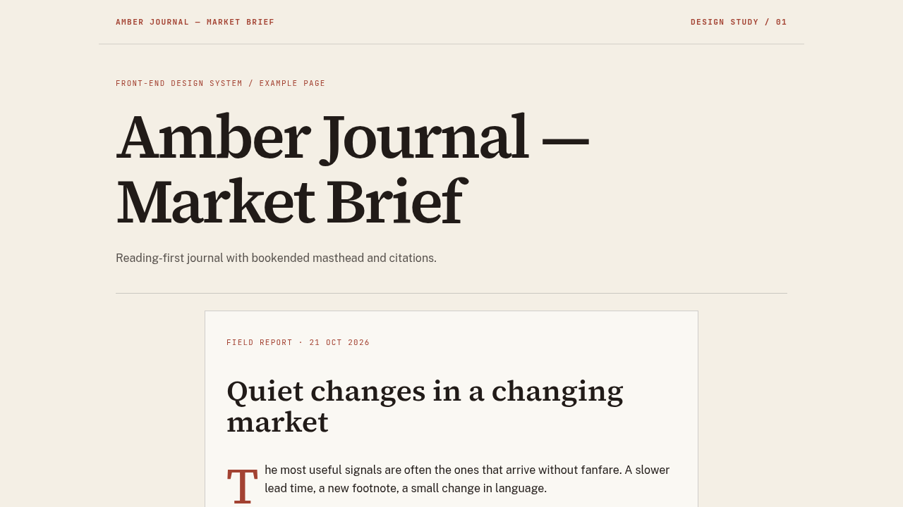</a><br>
      <sub>Spec: <a href="frontend-design/New-DesignSystems-Experimental/Amber-Parchment-Journal.md"><code>Amber-Parchment-Journal.md</code></a></sub>
    </td>
    <td width="50%" valign="top">
      <strong>Concrete Brutalist Forge</strong><br>
      <a href="examples/design-system-examples/concrete-brutalist-forge.html">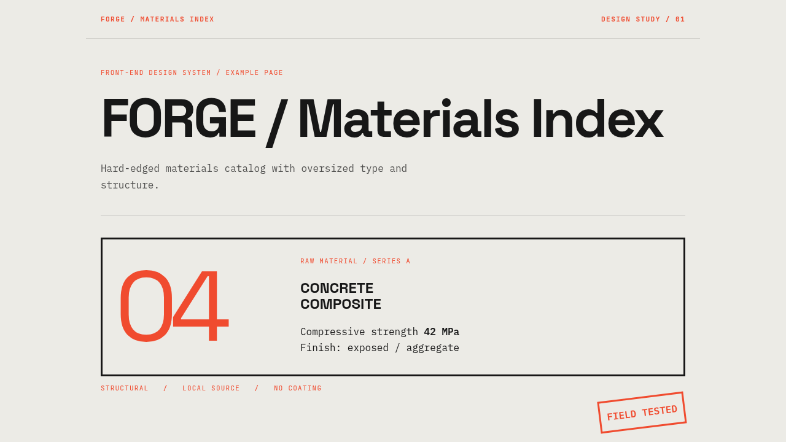</a><br>
      <sub>Spec: <a href="frontend-design/New-DesignSystems-Experimental/Concrete-Brutalist-Forge.md"><code>Concrete-Brutalist-Forge.md</code></a></sub>
    </td>
  </tr>
  <tr>
    <td width="50%" valign="top">
      <strong>Signal / Void Minimal</strong><br>
      <a href="examples/design-system-examples/signal-void-minimal.html">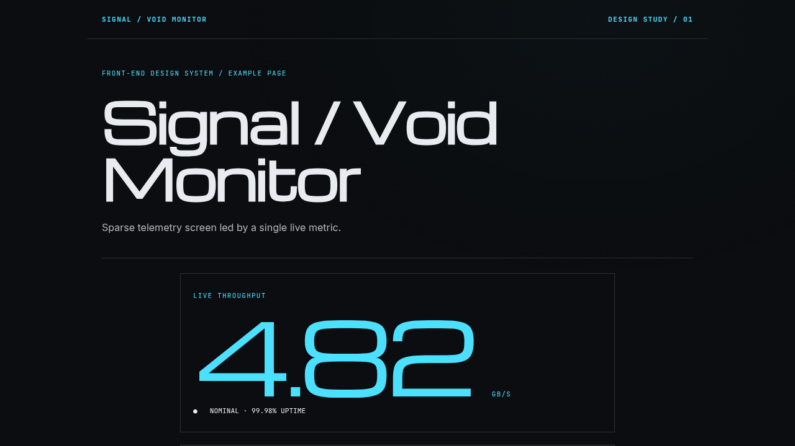</a><br>
      <sub>Spec: <a href="frontend-design/New-DesignSystems-Experimental/Signal-Void-Minimal.md"><code>Signal-Void-Minimal.md</code></a></sub>
    </td>
    <td width="50%" valign="top">
      <strong>Control Room</strong><br>
      <a href="examples/design-system-examples/control-room-design-system.html">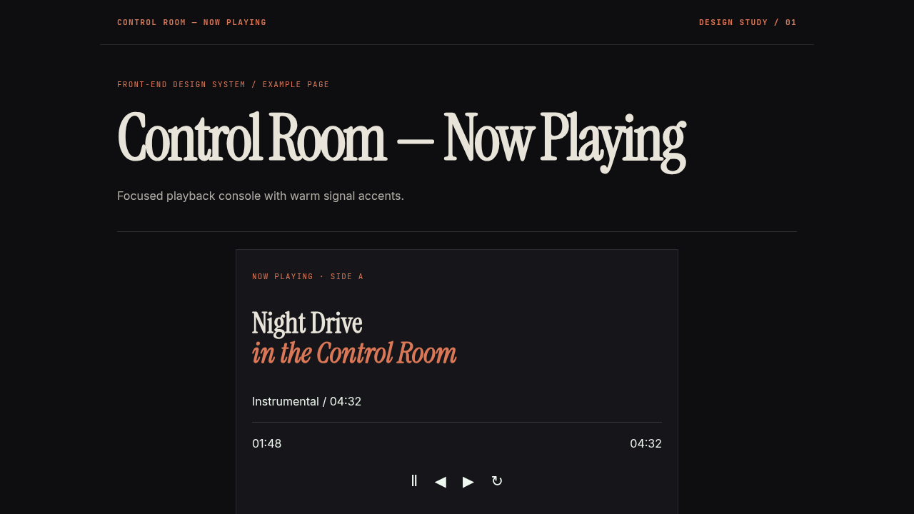</a><br>
      <sub>Spec: <a href="frontend-design/control-room-design-system.md"><code>control-room-design-system.md</code></a></sub>
    </td>
  </tr>
  <tr>
    <td width="50%" valign="top">
      <strong>PaperOS</strong><br>
      <a href="examples/design-system-examples/paperos-designsystem-skill.html">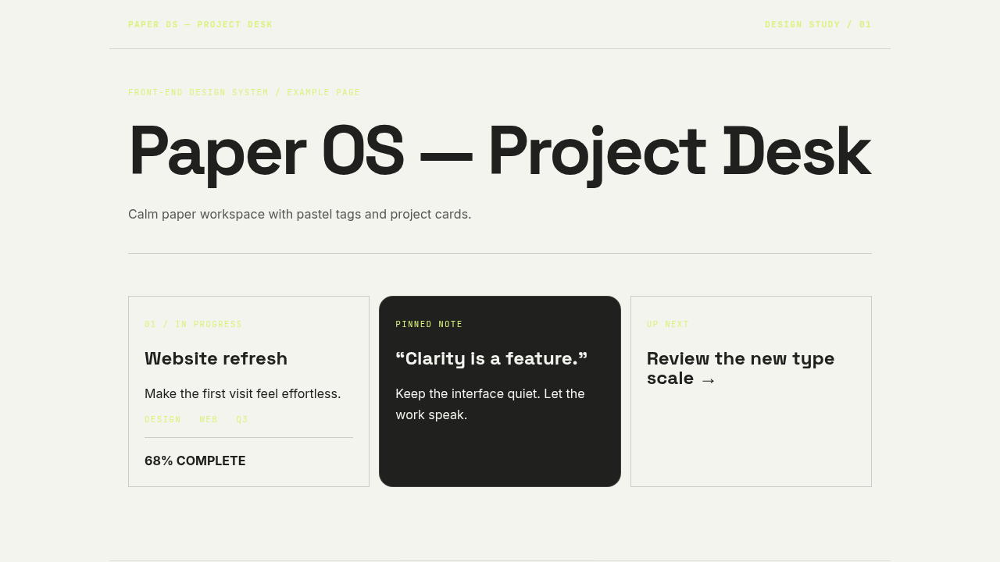</a><br>
      <sub>Spec: <a href="frontend-design/PaperOS%E2%80%94DesignSystem-SKILL.md"><code>PaperOS—DesignSystem-SKILL.md</code></a></sub>
    </td>
    <td width="50%" valign="top">
      <strong>NVMe → eGPU Guide</strong><br>
      <a href="examples/design-system-examples/nvme-egpu-design-skill.html">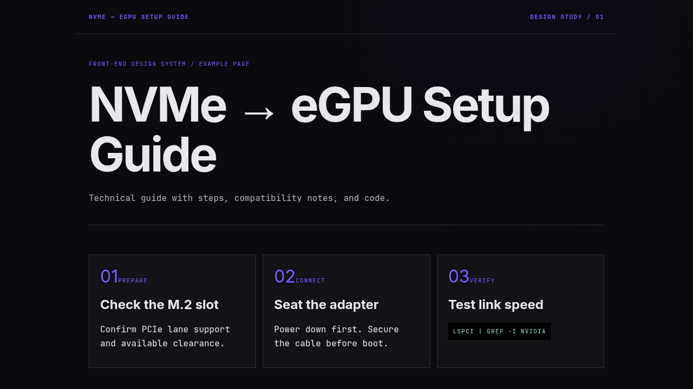</a><br>
      <sub>Spec: <a href="frontend-design/nvme-egpu-design-SKILL.md"><code>nvme-egpu-design-SKILL.md</code></a></sub>
    </td>
  </tr>
  <tr>
    <td width="50%" valign="top">
      <strong>Volga Partners</strong><br>
      <a href="examples/design-system-examples/volga-partners-frontend-design.html">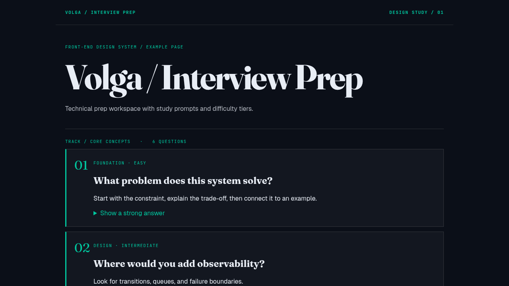</a><br>
      <sub>Spec: <a href="frontend-design/volga-partners-frontend-design.md"><code>volga-partners-frontend-design.md</code></a></sub>
    </td>
    <td width="50%" valign="top"></td>
  </tr>
</table>

---

## What a skill produces

Given any ordinary HTML file, the skill rewrites **only the design system** — semantic content, copy, and code blocks are preserved. The output is a single self-contained HTML file with:

- A custom CSS token system (`:root` + `[data-theme="light"]`)
- A strict type family (serif display + sans body + monospace labels)
- Masthead, hero, meta-bar, ruled dividers, section headers, accordion panels
- A persistent theme toggle with `localStorage`
- Staggered page-load entrance animation
- Responsive collapse at 860px
- Print stylesheet

No CSS framework. No JS framework. No build pipeline. Only three Google Fonts.

---

## Using a skill

The workflow is three steps:

1. **Load the skill** into your assistant. Agents that support a `skill` tool pick up `.md` files in `frontend-design/` automatically. If yours doesn't, paste the entire file into the system prompt.
2. **Provide the HTML** you want revamped — as a file path or pasted inline.
3. **Write a short prompt:**

```text
Using the frontend-design skill at frontend-design/<name>.md, update this HTML
file: <path>. Preserve all content, copy, and code blocks. Only the design
system (CSS + structure where needed) should change.
```

### Choosing a system

| You want... | Use... |
|---|---|
| An authoratative, data-dense technical interface | `DeepNavy-HighQuality-Terminal-Aesthetics.md` (system #1) |
| A warm, print-inspired journal or field manual | `skill.md` (default editorial craft, system #2) |
| A financial-journalism report with gold accents and inversion panels | `Dark-Gold-Editorial-Report.md` (system #4) |
| A hacker-terminal dashboard with animated glows | `CyberPunk-Animated-Terminal-v1.md` or the v2 Claude variant (system #5) |
| The original DeepNavy spec (predecessor of #1) | `DeepNavy-Fraunces-Pro.md` (system #3) |

---

## What the skills actually change

| Area | Before (typical) | After (any skill applied) |
|---|---|---|
| Background | Flat dark `#070b12` | Layered — grid texture + scanline + ambient glow |
| Headings | `Syne` 800, gradient-clip text | Variable serif (`Fraunces` / `DM Serif Display`) with italic accent words |
| Body | One mono font everywhere | Sans body + monospace labels (dual or tri-family stack) |
| Cards | `border-radius: 2px` + cyan stripe | Sharp corners, left-border accent, hover state |
| Code | Bordered slate | Dark near-black background + sage-green text + teal accent border |
| Theme | None | Toggle (◑ or ◐), `[data-theme]`, 0.4s transition, `localStorage` |
| Print | Full navigation clutter | All accordions expanded, nav hidden, white background |

---

## Repository structure

```
.
├── index.html                                  ← live example (system #1, this is the repo index)
├── README.md                                   ← you are here
├── emojis.md
├── frontend-design/
│   ├── skill.md                                ← system #2 (editorial craft, default)
│   ├── DeepNavy-HighQuality-Terminal-Aesthetics.md  ← system #1 (used by index.html)
│   ├── DeepNavy-Fraunces-Pro.md                ← system #3 (ancestor of #1)
│   ├── Dark-Gold-Editorial-Report.md           ← system #4
│   ├── CyberPunk-Animated-Terminal-v1.md       ← system #5 (v1)
│   └── Claude-Skills/
│       ├── Claude-default-SKILL.md
│       ├── CyberPunk-Animated-Terminal-v2.md   ← system #5 (v2, Claude-packaged)
│       ├── frontend-design-extractor-dfk.skill
│       └── frontend-design-extractor-Claude.md
└── examples/
    ├── Dark-Gold-Editorial-Report.html          ← system #4, rendered
    ├── CyberPunk-Animated-Terminal-v2.html      ← system #5 (v2), rendered
    ├── CyberPunk-Animated-Terminal-v1.md        ← system #5 (v1), runnable HTML in a .md file
    └── BaseHtml-Revamped-with-DesignSkill/
        └── BaseUI-and-Revamped-Ui-Files/
            ├── base-html-file.html              ← original (pre-skill)
            ├── Revamped_By-DeepseekV4-flash.html
            └── Revamped_by_Minimax-m3-free.html
```

---

## Cross-model consistency

The `BaseHtml-Revamped-with-DesignSkill/` example proves the skills work across model providers. The same base HTML was revamped by two different LLM routes — **DeepSeek V4 Flash** (NVIDIA NIM) and **MiniMax-M3 Free** (OpenCode Zen) — and both outputs converge on the same design system. They differ only in micro-details (comment density, formatting). This is because each skill is precise enough to remove ambiguity.

---

## Extending a skill

Every skill is a single Markdown file. Edit it freely:

- **New colour tokens** — add to `:root` and `[data-theme="dark"]` / `[data-theme="light"]`.
- **New components** — add a section and renumber.
- **Different aesthetic direction** — the load-bearing rules (zero `border-radius`, no blurred shadows, no glassmorphism, strict font stacks) are what make each system recognizable. Override them and you get a different design system.

Each skill has one signature fingerprint — dropping it makes the output generic:

| System | Signature fingerprint |
|---|---|
| #1 DeepNavy | Teal `border-top` on masthead + asymmetric 1.3fr/1fr hero |
| #2 Editorial Craft | `em` rust-italic in headings with `SOFT`/`WONK` axes |
| #4 Dark-Gold | Full-bleed dark masthead with gold verdict strip |
| #5 CyberPunk | Animated scanning chromatic gradient stripe on card tops |

---

## License

MIT. Use it, fork it, ship it.